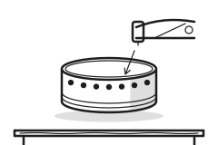
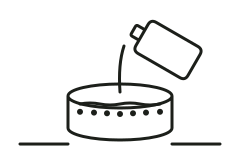
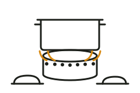

## Punch a ring of holes

Punch holes all the way around the side, just below the top rim, about half an inch apart.

## Pour in the fuel

Set the can on a flat, fireproof spot. Fill it about halfway. Close the fuel bottle and move it far away.

## Light it

Light the fuel with a long match. Keep your face and hands back. Look for a shimmer of heat if you cannot see a flame.

## Put the pot on

Wait about 30 seconds, until flames come out of the side holes. Then set the pot right on top of the can.

## Let it burn out

Let the fuel burn out, or cover the can with a metal lid. Wait until it is cold before you touch or refill it.
