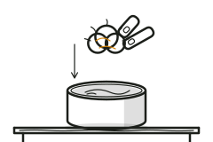

## Gather the supplies

Get cotton balls, a jar of petroleum jelly and a zip bag. Synthetic "cotton" balls do not work.

## Work in the jelly

Rub jelly into each cotton ball until it is well coated but not dripping.

## Pack them

Put them in the zip bag or pill bottle and keep it in your emergency kit. They last for years.

## Fluff and light

Pull a ball apart so dry fibers stick out. Set it under small twigs and light the fluffy part. It burns for a few minutes.
