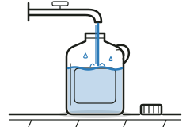
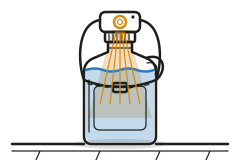
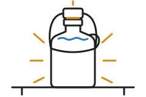

## Fill the jug

Fill the jug with water and put the cap back on. Milky-white jugs spread the light best.

## Strap the light on

Put the headlamp strap around the jug with the light facing in, toward the water.

## Turn it on

Turn the light on and set the jug in the middle of the room. Use the lowest setting to save battery.
