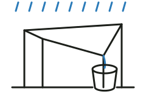

## Tilt the tarp

Tie the tarp between four posts so one corner hangs lower than the rest. Put a clean bucket under the low corner.

## Let the first rain rinse it

Throw away the first few minutes of water. It washes dirt and bird droppings off the tarp.

## Cover what you catch

Put a lid on the bucket when it is full, and move the water into clean containers.

## Boil it

Boil the water for 1 minute (3 minutes above 6,500 feet), or disinfect it, before you drink it.
