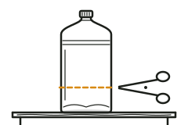
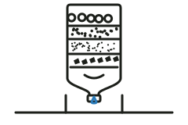

## Cut the bottle

Cut the bottom off the bottle. Take the cap off. Turn the bottle upside down over a jar, neck down.

## Fill the layers

Put the cloth in the neck. Add layers about 2 inches deep: crushed charcoal, fine sand, coarse sand, then gravel on top.

## Pour slowly

Pour the dirty water in at the top, slowly. Throw away the first jar of water: it rinses out the dust.

## Boil it

Bring the filtered water to a rolling boil for 1 minute (3 minutes above 6,500 feet). Let it cool before you drink it.
