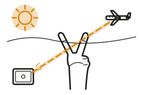

## Make a big X or V

On open ground, lay out a big X or V with rocks, logs or branches. Make each line longer than you are tall, and bigger if you can.

## Know what they mean

A V means "we need help." An X means "we need medical help." Use colors that stand out from the ground.

## Aim a mirror flash

Hold out your hand with two fingers in a V around the plane or boat. Tilt the mirror until the spot of light falls between your fingers.

## Three of anything

Three of anything means help: three whistle blasts, three shouts, three flashes. Wait a minute, then repeat.
