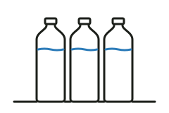
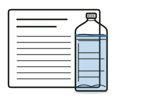

## Use clear bottles

Use clear plastic bottles that hold 2 liters or less. Take the labels off so the sun can shine through.

## Check the water is clear

Hold the filled bottle over a page of large print. If you cannot read it, filter or settle the water first.

## Shake, then fill to the top

Fill the bottle three-quarters full, cap it and shake it for 20 seconds. Then fill it to the top and close it.

## Lay them in full sun

Lay the bottles on their side in full sun for at least 6 hours. On a cloudy day, leave them for 2 days.

## Drink from the bottle

Keep the water in the bottle and drink straight from it. Do not use this method on days of steady rain.
