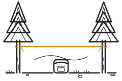
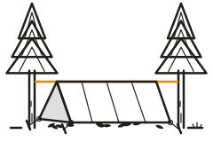

## Tie the ridge line

Tie a rope tight between two trees, about waist high. Pick a spot on high, flat ground.

## Hang the tarp

Hang the tarp over the rope so the same amount hangs down each side. Put the closed side toward the wind.

## Stake the corners

Tie a cord to each corner and to a stake or a heavy rock. Pull the sides out tight so rain runs off.

## Insulate the ground

The ground pulls heat out of you. Lay a thick bed of dry leaves, pine needles or a pad under you.
