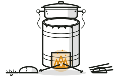

## Get the can ready

Take off the label and wash the can. Leave the bottom on: the can stands upside down, so the bottom becomes the cooking top.

## Cut a door

Wear gloves. At the open edge, cut two slits about 3 inches long and 3 inches apart. Bend the flap out or cut it off.

## Punch smoke holes

Punch a ring of holes around the side, just below the top, with the pointed can opener. Smoke leaves through them.

## Burn it once, empty

Outside, burn a few twigs inside it before you cook. This burns off any paint or coating.

## Cook on top

Set it on bare dirt or rock. Feed small twigs through the door, and set your pot or pan on top.
