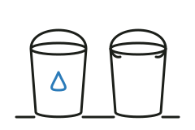
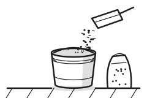
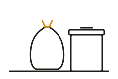

## Set up two buckets

Mark one bucket for pee and one for poop. Keeping them apart cuts the smell a lot. Line the poop bucket with a heavy trash bag.

## Pee bucket

Empty the pee bucket on the ground outside, away from water, gardens and wells. Rinse it with a little water.

## Cover each time

After each use of the poop bucket, cover it with a scoop of sawdust, shavings, paper or litter. Keep the lid on.

## Wash your hands

Wash with soap and water every time, or use hand sanitizer.

## Bag it and store it

When the bag is half full, tie it shut and put it in a second bag. Store it in a lidded bin outside until trash pickup comes back.
